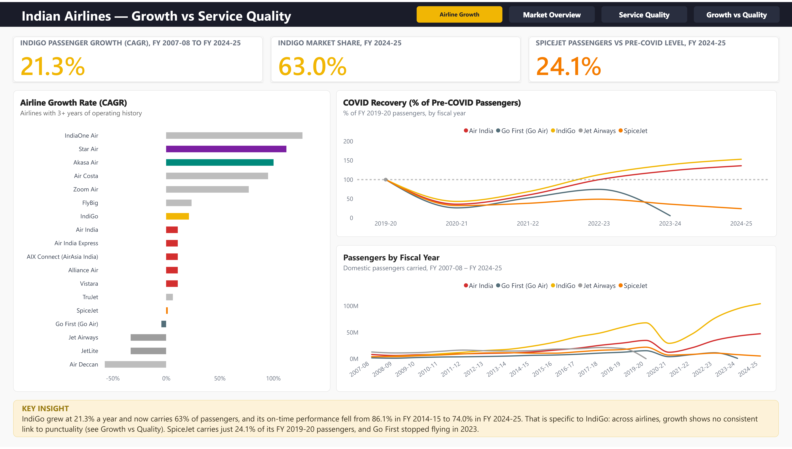
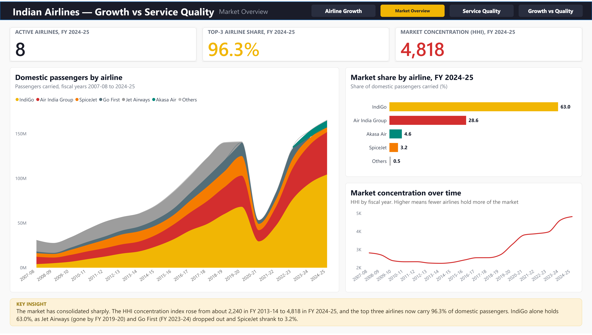
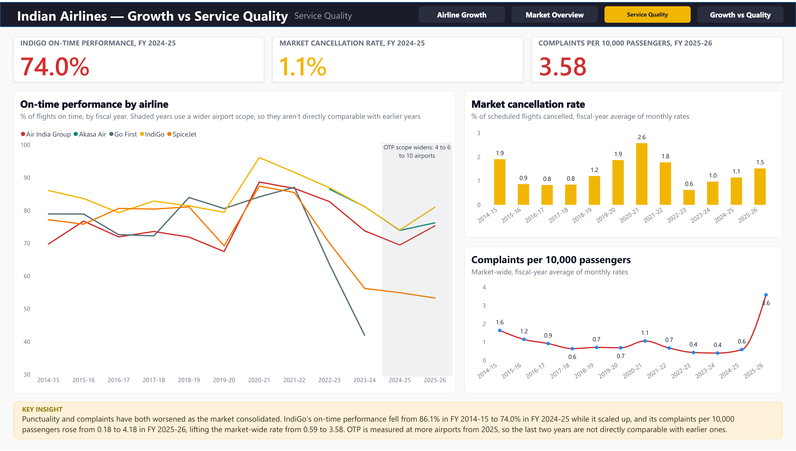
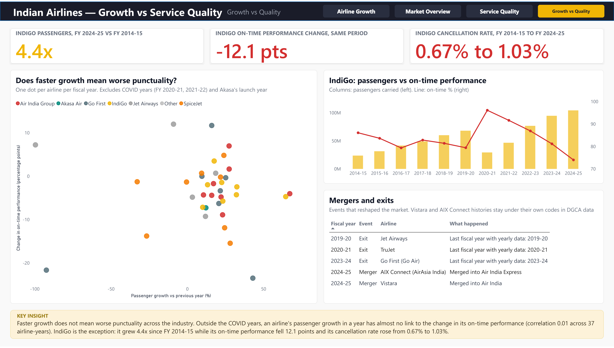

# Indian Airlines: Growth vs Service Quality

Are India's fastest-growing airlines keeping up on service quality, or is growth hurting punctuality, cancellations, and complaints?

Public DGCA data, extracted from PDFs and Excel files → PostgreSQL → Power BI.

**Tools:** Python (pdfplumber, pandas, openpyxl), PostgreSQL 17 in Docker, SQL views, Power BI.

## Dashboard

Four pages: airline growth, market overview, service quality, and growth vs quality. The PDF is a static copy ([dashboard/indian-airlines-dashboard.pdf](dashboard/indian-airlines-dashboard.pdf)). For the interactive version, open [dashboard/indian-airlines-growth-vs-service.pbix](dashboard/indian-airlines-growth-vs-service.pbix) in Power BI Desktop. The data is stored in the file, so no database is needed to view it. The report is not hosted online.






## Key findings

1. **Growth does not systematically hurt service across airlines. IndiGo is the clear exception.** Across 37 airline-years (COVID years and Akasa's launch year excluded), a year's passenger growth has almost no link to the change in on-time performance (correlation 0.01). Including the two COVID years it looks like a weak negative link (-0.26), but that comes from FY 2020-21, when traffic collapsed and OTP jumped because there was less traffic to delay.
2. **IndiGo scaled 4.4x and got less punctual.** Passengers went from 23.7 lakh (FY 2014-15) to 104.2 lakh (FY 2024-25), a 21.3% CAGR over FY 2007-08 to FY 2024-25. Over the same period on-time performance fell from 86.1% to 74.0% and its cancellation rate rose from 0.67% to 1.03%. SpiceJet and Go First lost punctuality while shrinking, so the link is not general.
3. **Complaints spiked in FY 2025-26.** Total complaints went from 9,717 (FY 2024-25) to 61,514. Market-wide complaints per 10,000 passengers went from 0.59 to 3.58, and IndiGo's own rate from 0.18 to 4.18. The data does not give a cause, so none is claimed.
4. **The market consolidated sharply.** The HHI concentration index rose from 2,242 (FY 2013-14) to 4,818 (FY 2024-25). The top three airlines carry 96.3% of passengers and IndiGo alone 63.0%, after Jet Airways (gone by FY 2019-20) and Go First (FY 2023-24) left and SpiceJet shrank.
5. **Not every airline recovered from COVID.** By FY 2024-25 IndiGo carried 153% of its FY 2019-20 passengers and the Air India family 136%. SpiceJet carried 24.1%, and Go First fell to 5.7% in FY 2023-24 before it stopped flying.
6. **Mergers distort airline-level growth.** Air India's passenger count jumps about 50% in FY 2024-25 because Vistara moved into it. Grouped as the Air India family (Air India, Air India Express, Alliance Air, Vistara, AIX Connect), growth is +10.7%. All analysis is grouped this way.

Caveats that apply to the findings:
- **OTP scope changed twice.** It is measured at 4 airports to December 2024, 6 airports in 2025, and 10 from January 2026. FY 2024-25 mixes 4 and 6, and FY 2025-26 mixes 6 and 10. The service quality page shades these years, and they are not directly comparable with earlier years.
- FY 2014-15 has monthly data for 10 of 12 months (no reports for April and May 2014). FY 2026-27 is left out of the charts because it has only five months.
- Airline-level OTP, cancellation, and complaint rates are fiscal-year averages of the monthly rates, weighted by that month's passengers. The market-wide cancellation and complaint figures are plain averages of the monthly figures, because DGCA does not print a passenger base for them.
- The growth vs cancellation correlation is unstable (it changes sign once tiny start-up years are dropped), so no claim is made about it.

## Data sources

- **DGCA Table 1.04 / 1.07** (yearly, per airline, scheduled domestic services, fiscal years April to March). Table 1.04 is the main source. Table 1.07 is used only to validate our own calculations.
- **DGCA monthly Air Traffic reports** (June 2014 to August 2026, calendar months). The only source for on-time performance, cancellations, and complaints.

Fiscal years (April to March) are used for yearly tables. Monthly data keeps both the calendar month and the fiscal year. The main comparison window is FY 2015-16 to FY 2024-25, where both sources have full years.

## How the data was checked and what was wrong with it

- Every derived metric (load factor, stage distance, speed, and so on) is recalculated from the raw columns. The database stores our own values, and DGCA's printed ratios are kept only for comparison.
- Monthly passenger tables are checked against their own printed totals (144 of 146 reports pass), and complaint rates against each report's stated total complaints (145 of 146 pass).
- Monthly figures summed by fiscal year match the yearly tables within 1% for 48 of 55 airline-years with at least 10 lakh passengers.

DGCA's own tables contain errors. Three examples found and handled:

- **Air India, Table 1.04, 2024-25 edition:** the whole weight load factor column is shifted down one row, so every year shows the previous year's value. Found by comparing with the 2023-24 edition and fixed by recomputing the ratio from raw columns.
- **IndiGo, Table 1.04, FY 2020-21:** load factor printed as 0.7%. The real value is 28,218 ÷ 41,048 × 100 = 68.7%.
- **Air India, Table 1.07, FY 2021-22:** average stage distance printed as 117.5 km. From Table 1.04 it is 1,172.6 km.

The full list, including the suspicious values left unfixed and the DGCA website problems, is in [docs/data-issues.md](docs/data-issues.md).

## Project structure

```
data/
  samples/          sample PDFs used to work out the layouts
  raw/              source files as downloaded, untouched
    yearly_airline/   yearly airline tables (Excel), one folder per edition + catalog.csv
    monthly_traffic/  monthly Air Traffic report PDFs + manifest.csv
  interim/          raw extracts from each PDF (one CSV per file)
  processed/        clean tables ready to load into PostgreSQL
  reference/        hand-built lookup tables (airline name mapping)
src/
  download/         download scripts for the monthly reports and yearly tables
  parsers/          parsers for the yearly tables and the monthly reports
  validation/       recalculates derived metrics and logs mismatches with DGCA
  load/             loads the CSVs into PostgreSQL and builds the analysis views
sql/
  schema/           table definitions (dimensions, yearly/monthly facts, indexes)
  analysis/         analysis views (growth, concentration, service quality, COVID recovery, events)
dashboard/          Power BI file, PDF export, page screenshots
docs/               notes, data issues log
logs/               parser and validation logs (loaded into the data_issue table)
```

## Setup

```
pip install -r requirements.txt
python src/download/download_monthly_traffic.py   # ~146 PDFs, ~185 MB
python src/download/download_yearly_airline.py    # yearly airline tables (Excel)
```

Both scripts skip files already downloaded and write a manifest/catalog of what they fetched.

Parsers (`src/parsers/`) turn the raw files into the CSVs in `data/processed/`. Database:

```
docker compose up -d                  # PostgreSQL 17, localhost:5432, see docker-compose.yml for credentials
python src/load/load_postgres.py      # builds the schema (sql/schema/) and loads every processed CSV + log
python src/load/build_views.py        # builds the analysis views (sql/analysis/)
```

The load script is idempotent: it drops and rebuilds all tables each run, so re-run it after re-parsing. Run `build_views.py` after it, or on its own after changing a view.
