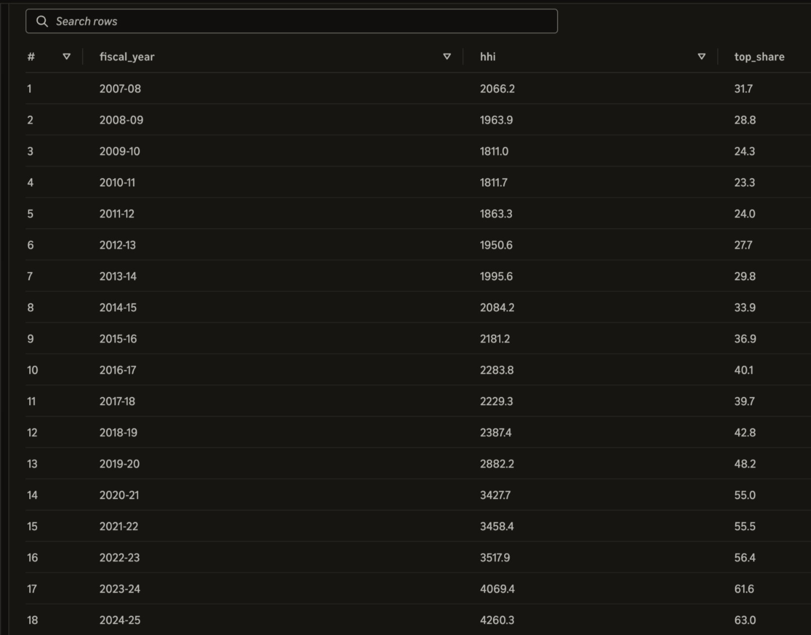

# One-off Athena check: ungrouped airline HHI

A small manual cross-check, recorded here for transparency. It is **not** an automated data
pipeline, a big-data workload or a deployment.

## What was done

Shaurya manually uploaded `data/processed/yearly_airline_domestic_history.csv` (about 47 KB) to
Amazon S3 in `ap-southeast-2` (Sydney), defined an Athena external table over it, and ran the SQL in
[`athena_queries.sql`](athena_queries.sql). The table uses OpenCSVSerde (every column is a string, so
`passengers` is cast to `double` in the query) and skips the CSV header row.

## Result (user-reported)

| Fiscal year | Ungrouped airline HHI |
|---|---|
| 2013-14 | 1,995.6 |
| 2024-25 | 4,260.3 |

The screenshot above is the Athena results grid. The two figures in the table are the FY 2013-14 and FY 2024-25 rows of it. They match the explicitly labelled
"without family grouping" values in the [PySpark README](../spark/README.md) (1,995.6 and 4,260.3).

## Formula

Each airline's share is `100 * airline passengers / sum of included airline passengers` for that
fiscal year (airlines with zero passengers excluded). HHI is the sum of squared percentage shares, on a
0-10,000 scale. **No airline-family grouping is applied.**

## Why this does not match the main README (by design)

The main project reports **family-grouped** HHI, about **2,242** (FY 2013-14) and **4,818** (FY 2024-25),
because related airlines are grouped first (for example Air India, Air India Express, Alliance Air,
Vistara and AIX Connect become one family). Grouping makes the market look more concentrated, so the two
sets of numbers answer different questions. The difference is expected and is not a failed validation.

Two further limits:
- Early-year source coverage limits still apply: the airline file is incomplete for FY 2007-08 to
  2012-13 (see the reconciliation notes in the [PySpark README](../spark/README.md)).
- Two methods agreeing does not prove the source data is complete. Matching the PySpark comparison
  checks the arithmetic on one CSV, not the data.

## Evidence status

A cropped screenshot of the Athena results grid is included as [`athena_result.png`](athena_result.png). It was
captured on 2026-11-20 from a browser tab left open from the original run (as reported by Shaurya). It shows 18
fiscal-year rows with `hhi` and `top_share`. It does **not** show the SQL text, a query ID, the execution date, the
region or the account, and no result export was saved, so the repo cannot prove which exact query produced it or when
it ran.

The Athena execution itself was **not re-run or independently verified** by this documentation change, which used no AWS
access. What was checked offline:
- the SQL's column list matches the CSV header (20 columns, same order);
- a plain Python recalculation using the same formula on the same CSV reproduces **all 18 rows** read from the
  screenshot (both `hhi` and `top_share`, to one decimal), including 1,995.6 and 4,260.3.

That shows the screenshot's numbers are consistent with this CSV and formula. It does not show which SQL ran or when,
and no automated test here executes Athena.

## Cleanup status (reported, not verified)

Shaurya reports completing these steps: dropping the Athena table, dropping the Athena database,
deleting the uploaded input object(s)/bucket, and cleaning the Athena query-results location. This
documentation change had no AWS access and has not verified any of them. Note that Athena `DROP TABLE`
removes only table metadata, not the files in S3, so the S3 input and the query-results location are
separate cleanup steps.

Because the original resources were removed, the S3 `LOCATION` in the SQL is a **placeholder**. The
original bucket name is intentionally not published.

## Scope

This is one manual query on one small CSV. It uses no Glue, EMR, Redshift, Lambda or orchestration and
makes no scale or performance claim. The PySpark analysis in [`spark/`](../spark/README.md) is a
separate local analysis.

## To reproduce (not done by this change)

You would need your own bucket and prefix holding only that CSV, an Athena query-results location (or a
workgroup that manages results), and permission to create resources and run queries, which may incur
small AWS charges. See the AWS documentation on the
[CSV SerDe and header skipping](https://docs.aws.amazon.com/athena/latest/ug/csv-serde.html),
[DROP TABLE leaving S3 data intact](https://docs.aws.amazon.com/athena/latest/ug/drop-table.html) and
[query-results storage](https://docs.aws.amazon.com/athena/latest/ug/query-results-specify-location.html).
